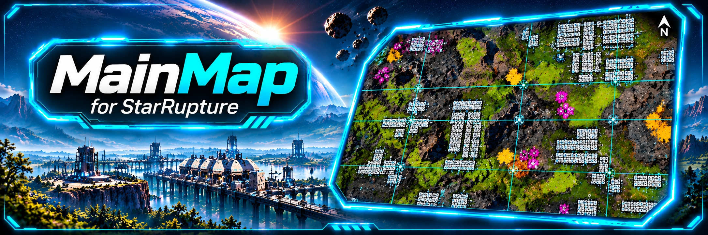
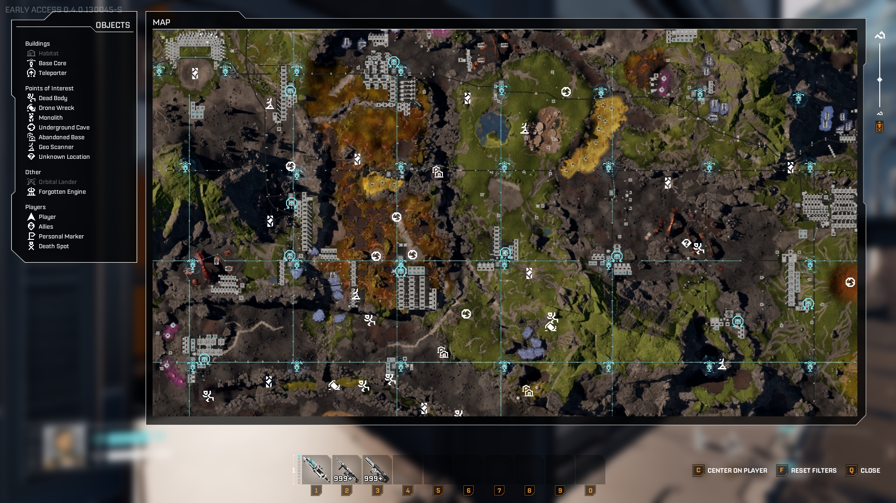
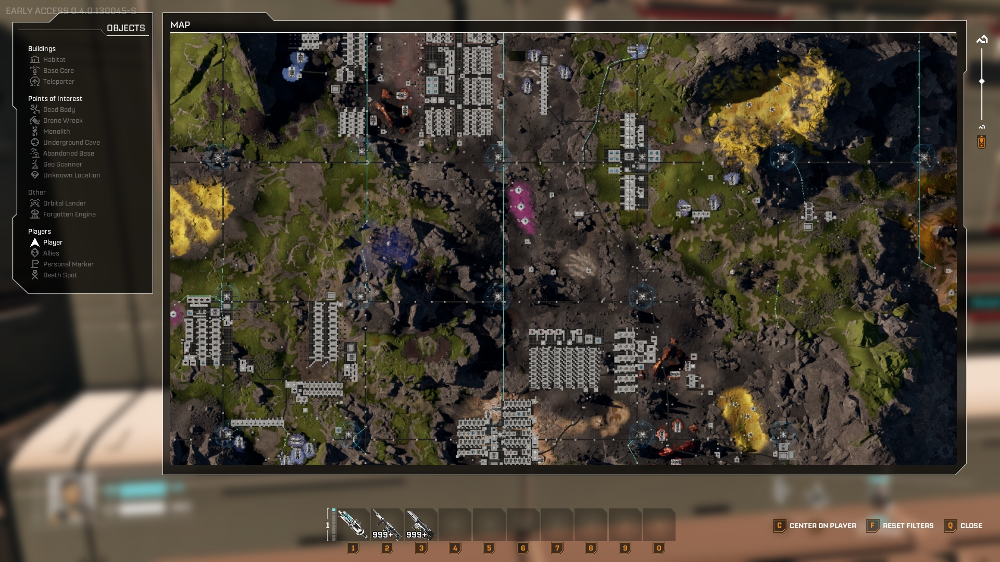
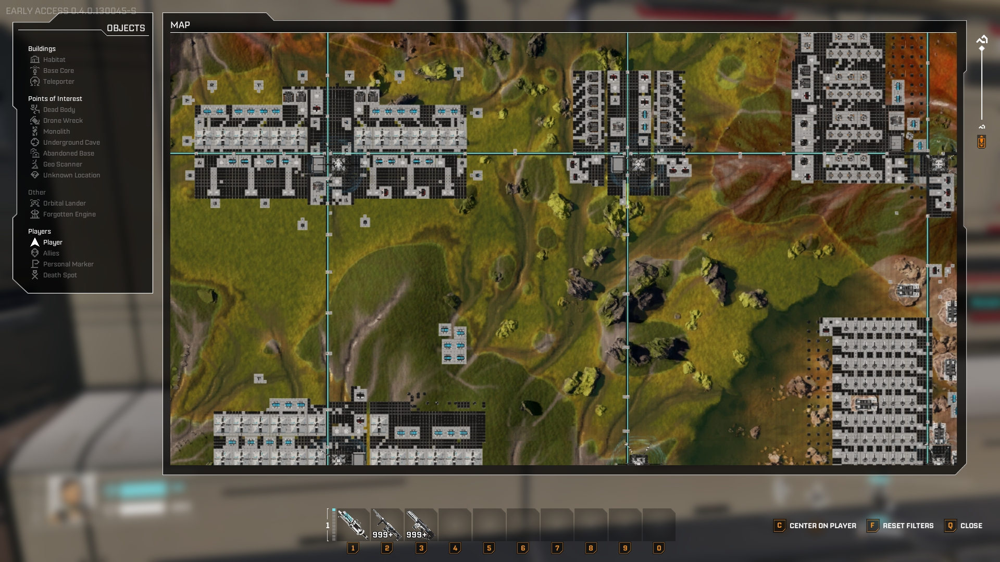
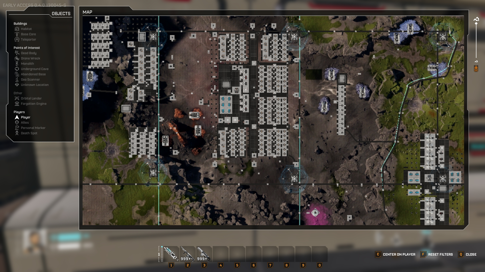

# MainMap mod for StarRupture



[Watch the MainMap Showcase on YouTube](https://www.youtube.com/watch?v=c1P9LzkxvQ4)

**Your buildings. Your world.**

See what you've built like never before.

MainMap enhances StarRupture's native world map by bringing your constructed buildings, factories and transport networks directly onto the map. From individual production facilities to sprawling industrial complexes spanning vast areas of the world, MainMap gives you a whole new perspective on your creations.

Designed as a companion mod to MiniMap, MainMap extends its detailed building visualization technology to the game's full world map while preserving the familiar map interface and navigation controls.

## Features

### Detailed Building Visualization

See the actual layouts of your constructed buildings directly on the world map. Rather than representing your factories with generic markers, MainMap displays detailed building imagery that allows you to recognize your structures, production facilities and infrastructure.

### Expanded World Map

Make better use of your screen space with an enlarged world map. Enjoy a broader view of your surroundings and a more convenient overview of your factory complexes and transport networks.

### Optional Fog of War

Choose whether to display or hide the Fog of War covering unexplored areas of the world map. Hiding the Fog of War is purely visual and does not modify your exploration progress.

### Toggle Building Visibility

Show or hide the building overlay independently of the other map features. Easily switch between the original terrain map and the enhanced map displaying your constructions.

### Native Map Integration

MainMap enhances the existing StarRupture map rather than replacing it. The familiar terrain, map markers, panning and zooming functionality remain available, with building imagery correctly aligned to the world as you navigate.

### Live Configuration

Customize your map while playing. Changes to the available settings can be applied while the world map is open.

### A Companion to MiniMap

MiniMap helps you navigate your immediate surroundings, while MainMap gives you the big picture. Both mods share the same underlying building visualization technology, providing a complementary mapping experience.

## Screenshots









## Configuration

MainMap's settings are accessible through AlienX Mod Loader's in-game menu (F2).

| Setting | Default | Description |
| --- | --- | --- |
| Expanded Map | Enabled | Enlarges the native world map to provide more viewing space. |
| Hide Fog of War | Disabled | Hides the visual Fog of War without modifying exploration progress. |
| Show Buildings | Enabled | Displays constructed buildings and infrastructure on the world map. |

All three features can be configured independently to suit your preferences.

## Requirements

- [AlienX Mod Loader](https://www.nexusmods.com/starrupture/mods/89)
- [MiniMap](https://www.nexusmods.com/starrupture/mods/150)

Download the latest compatible releases of MainMap, MiniMap, and AlienX Mod Loader.

## Installation

Install AlienX Mod Loader and MiniMap, then download the MainMap Client Release package.

1. Right-click StarRupture in Steam and select **Manage > Browse local files**.
2. Navigate to `StarRupture\Binaries\Win64\ModLoader\`.
3. Extract the MainMap Client Release ZIP into that `ModLoader` directory. Its `Plugins/` folder places the files in `StarRupture\Binaries\Win64\ModLoader\Plugins\`.

The ZIP contains:

```text
Plugins/
    MainMap.dll
    MainMap.pdb
    MainMap.json
```

Alternatively, copy `MainMap.dll`, `MainMap.pdb`, and `MainMap.json` from the archive into the `ModLoader\Plugins\` directory directly.

## Two Mods - One Connected World

**MiniMap** - Navigate your surroundings and see your nearby buildings while playing.

**MainMap** - Explore the bigger picture and see your constructed world from the native world map.

Together, they provide a more informative mapping experience for StarRupture, whether you are exploring new territory, expanding your factory or managing an extensive industrial network.

## Source Code and License

The source code of MainMap is available in the [MainMap GitHub repository](https://github.com/LetMeInside/StarRupture-Plugin-MainMap) under the MainMap Source Available License. See [LICENSE](LICENSE) for details.

## Contributions

Contributions are welcome subject to review. External copyrightable contributions require agreement to the [Contributor Assignment and License Agreement](CLA.md) and an appropriately executed written copyright assignment before merge. See [CONTRIBUTING.md](CONTRIBUTING.md) for the limited contribution permission, execution requirements and submission process.

## Technical Documentation

Developers can read the [technical architecture documentation](Docs/Architecture.md) to understand MainMap's implementation.
